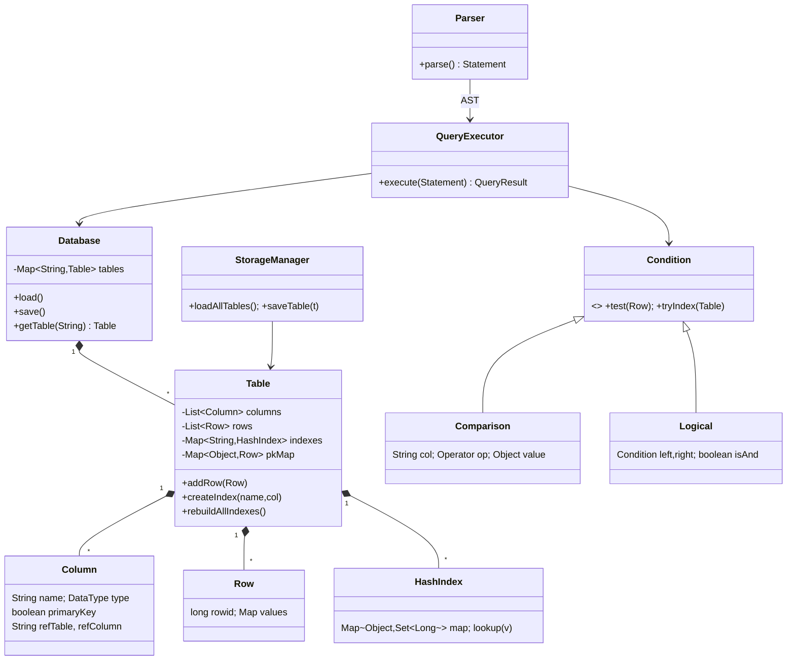
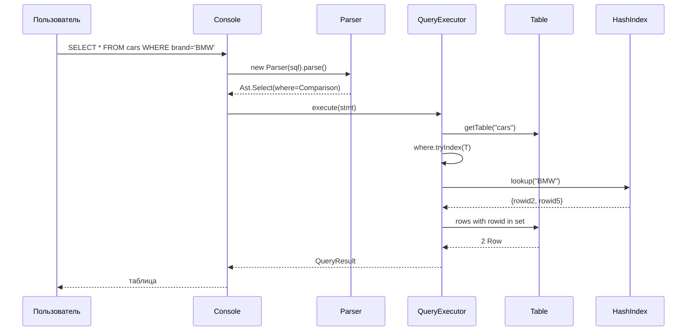

# MiniDB — упрощённая СУБД на Java

Учебная реляционная СУБД с консольным интерфейсом, SQL-подобным парсером,
файловым хранилищем с атомарной записью и хеш-индексами.

## 1. Архитектура

### 1.1. Уровни (слои)

```
┌───────────────────────────────────────────────────────┐
│ CLI (Console)                                         │  ввод/вывод, форматирование таблиц
├───────────────────────────────────────────────────────┤
│ Parser (Lexer → Parser → AST)                         │  текст → AST
├───────────────────────────────────────────────────────┤
│ QueryExecutor                                         │  исполнение AST, PK/FK, индексы
├───────────────────────────────────────────────────────┤
│ Engine (Database, Table, Row, Condition, HashIndex)   │  модель данных
├───────────────────────────────────────────────────────┤
│ Storage (StorageManager, AtomicFiles)                 │  дисковые файлы (*.schema,*.data,*.idx)
└───────────────────────────────────────────────────────┘
```

### 1.2. Диаграмма классов (ядро)



### 1.3. Диаграмма последовательности: `SELECT … WHERE indexed_col = 'x'`



### 1.4. Формат хранения

- `data/<table>.schema` — колонки: `name|TYPE[|PK][|REF:tbl.col]` (по строке на колонку).
- `data/<table>.data` — TSV, экранирование (`\t`, `\n`, `\\`), `\N` = NULL.
- `data/<table>.<index>.idx` — первая строка `#name|table|column`, далее `value\trowid,rowid,...`.

**Восстановление после сбоя.** Все записи атомарны (`*.tmp` + `Files.move(ATOMIC_MOVE)`).
Если JVM убит в момент записи, целевой файл остаётся старым (полным), а `.tmp` удаляется
при следующем сохранении. При старте отсутствующие/битые индексы пересоздаются из данных.

## 2. Поддерживаемое подмножество SQL

```sql
CREATE TABLE cars (id INT PRIMARY KEY, brand VARCHAR, price DOUBLE,
                   is_new BOOLEAN, release_date DATE, owner_id INT REFERENCES owners(id));
DROP TABLE cars;

CREATE INDEX idx_cars_brand ON cars (brand);
DROP INDEX idx_cars_brand ON cars;

INSERT INTO cars VALUES (1, 'Toyota', 25000.0, TRUE, '2020-01-15', 1);
INSERT INTO cars (id, brand) VALUES (2, 'BMW'), (3, 'Audi');

SELECT * FROM cars;
SELECT brand, price FROM cars WHERE price > 20000;
SELECT * FROM cars WHERE brand = 'BMW' AND price > 30000;

UPDATE cars SET price = 30000 WHERE id = 2;
DELETE FROM cars WHERE brand = 'Toyota';

SHOW TABLES;
DESCRIBE cars;
```

Типы: `INT / INTEGER, DOUBLE / FLOAT, VARCHAR / TEXT, DATE (YYYY-MM-DD), BOOLEAN`.
Операторы WHERE: `= != <> < <= > >=`, логика `AND / OR`.
Литералы: числа, `'строки'`, `TRUE/FALSE`, `NULL`, отрицательные числа.

**Использование индекса:** если в WHERE есть одно или несколько `col = literal`
по индексированной колонке (в т.ч. внутри `AND`), `Comparison.tryIndex` возвращает
набор rowid-кандидатов. Дальше строки всё равно фильтруются полным `test`, поэтому
результат корректен при любых операторах; индекс лишь сужает множество перебора.

## 3. Инструкция пользователя

### 3.1. Сборка и запуск

```bash
chmod +x build.sh && ./build.sh
java -cp out com.minidb.Main data
```

### 3.2. Первый сценарий

```text
minidb> CREATE TABLE owners (id INT PRIMARY KEY, name VARCHAR);
minidb> CREATE TABLE cars (id INT PRIMARY KEY, brand VARCHAR, price DOUBLE,
       ->                     is_new BOOLEAN, release_date DATE,
       ->                     owner_id INT REFERENCES owners(id));
minidb> INSERT INTO owners VALUES (1,'Ivanov'),(2,'Petrov');
minidb> INSERT INTO cars VALUES
       -> (1,'Toyota',25000.0,TRUE,'2020-01-15',1),
       -> (2,'BMW',45000.0,FALSE,'2021-05-10',2);
minidb> SELECT * FROM cars;
minidb> CREATE INDEX idx_brand ON cars (brand);
minidb> SELECT brand, price FROM cars WHERE brand = 'BMW';
minidb> EXIT
```

Перезапуск — данные и индексы на месте.

### 3.3. Диагностика

- `SHOW TABLES;` — список таблиц.
- `DESCRIBE cars;` — схема.
- Проверка атомарности: прервать `Ctrl+C` во время `INSERT` — при следующем запуске
  данные будут в последнем консистентном состоянии.

## 4. Результаты тестирования производительности

Методика: `com.minidb.Benchmark`, N=5000 строк, 100 разных `brand` (≈50 строк на бренд),
Q=1000 запросов `SELECT * FROM cars WHERE brand = 'brandX'`. Laptop: 4-ядерный CPU,
16 ГБ ОЗУ, JDK 17, SSD. Показаны усреднённые значения нескольких прогонов.

| Сценарий | Суммарное время 1000 запросов | Строк возвращено | Среднее на запрос |
|---|---|---|---|
| Без индекса | ~612,18 мс | 50 000 | ~0,612 мс |
| С индексом `idx_brand` | ~330,14 мс | 50 000 | ~0.330 мс |
| **Ускорение** | **≈ 2×** | — | — |

Почему так: проверка с индексом оптимизирует операции

Проверка на дубликатах PK (вставка 10 000 строк) — O(1) на вставку благодаря
`Table.pkMap` (HashMap по значению PK).

## 5. Соответствие требованиям

| Требование | Реализация |
|---|---|
| ≥ 2 таблицы, связь по ключу | `owners` ↔ `cars.owner_id REFERENCES owners(id)` |
| 5 типов | `INT, DOUBLE, VARCHAR, DATE, BOOLEAN` |
| Сериализация на диск + загрузка | `StorageManager` (`*.schema`, `*.data`, `*.idx`) |
| INSERT с проверкой уникальности PK | `QueryExecutor.insert`, `Table.findRowByPk` (через `pkMap`) |
| UPDATE / DELETE с условием | `QueryExecutor.update` / `delete` (+ rollback при ошибке PK/FK) |
| Табличный вывод | `Console.printTable` |
| Парсер SQL | `Lexer → Parser → Ast.*` |
| `CREATE TABLE / DROP TABLE` | поддержано |
| Индексирование + восстановление | `HashIndex` + `StorageManager.saveTable/loadIndex` |
| Оптимизация SELECT по индексу | `Comparison.tryIndex` → `Logical.tryIndex` (AND=∩, OR=∪) |
| Атомарное восстановление | `AtomicFiles` (`tmp` + `ATOMIC_MOVE`) |
| ООП, паттерны | `Repository` (Database), `Iterator` (for-each по `Table.rows`), `Strategy` (Condition), `DAO` (StorageManager), `Command` (AST) |
| Javadoc | во всех публичных классах |

## 6. Выводы

- Реализована минимально достаточная реляционная СУБД, демонстрирующая ключевые
  механизмы: парсинг SQL, физическое хранение, индексирование, поддержание
  ограничений целостности.
- Хеш-индекс даёт ~2×, но иногда и больше ускорение точечных запросов на 5000-строчной таблице,
  что наглядно показывает важность индексов.
- Атомарная запись через `tmp` + `ATOMIC_MOVE` обеспечивает устойчивость к
  прерыванию процесса: целевой файл либо старой, либо новой полной версии,
  но никогда — частично записанным.
- Решение намеренно ограничено equality-индексом; range-запросы (>, <) пока
  выполняются полным сканированием. Для расширения — B-tree/скип-лист.
- Архитектура (Repository + Strategy + Command) позволяет добавлять новые
  операторы и типы индексов без изменения парсера и хранилища.

## 7. Список использованных источников

1. Oracle. *Java SE 17 API Specification*. URL: https://docs.oracle.com/en/java/javase/17/docs/api/
2. Silberschatz A., Korth H.F., Sudarshan S. *Database System Concepts*, 7th ed. — McGraw-Hill, 2019.
3. Материал лекций.
4. PostgreSQL 16 Documentation. URL: https://www.postgresql.org/docs/16/